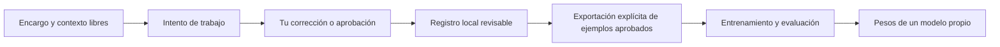

# IA Propia

Proyecto independiente para construir una IA propia y avanzar hacia un trabajador
digital que reciba encargos, conserve contexto y se ajuste a correcciones.
El nombre es provisional. La base usa Python y NumPy, funciona localmente y no
requiere Hormiga-X, una API de IA ni pesos preentrenados.

**Estado: base experimental, no trabajador autónomo ni chatbot competente.**
Una red pequeña aprende una tarea concreta; una inteligencia que resuelva encargos
abiertos necesita capacidades y pruebas adicionales. No hemos replicado a una
persona ni su forma completa de pensar.

## Qué contiene

- Un especialista de atención, entrenado desde pesos aleatorios y separado de
  Hormiga-X con su evidencia original. Predice una métrica numérica, no creatividad.
- Un modelo de lenguaje pequeño con entrenamiento propio. Su demostración sirve
  para comprobar que cambian los pesos y se puede generar texto; no demuestra
  comprensión ni calidad conversacional.
- Un registro local de encargos, intentos y correcciones en texto libre. No impone
  categorías de personalidad. Permite preparar ejemplos aprobados para entrenar,
  sin confundir memoria con aprendizaje de parámetros.

## Instalar

Python 3.11 o posterior:

```bash
python3 -m venv .venv
source .venv/bin/activate
python -m pip install -e .
ia-propia --help
python -m unittest discover -s tests -v
```

El paquete también se puede usar con `python -m ia_propia` después de instalarlo.
Los datos personales van en `private/`, excluido de Git. Los artefactos de `models/`
y textos de `examples/` son demostraciones identificadas, no datos personales.
Los modelos que entrenes con tus propios textos también deben guardarse en
`local-models/` o `private/`: pueden memorizar fragmentos del corpus. Si eliges
otra ruta, la exclusión de Git puede dejar de aplicar. Los permisos locales
no son cifrado.

## Primeros pasos

```bash
ia-propia init --workspace private/default
ia-propia task add --workspace private/default \
  --goal "Describe aquí un trabajo concreto" \
  --context "Qué importa hoy, fuentes disponibles y resultado deseado"
ia-propia task list --workspace private/default
```

El especialista ya guardado se puede reproducir sin entrenarlo de nuevo:

```bash
ia-propia trend predict --model models/attention-v1.json \
  --input examples/attention-observations.json \
  --as-of 2024-10-16T00:00:00Z --historical
```

Con las 30 capturas iniciales, su error en test todavía supera el de conservar
el último valor. El resultado está conservado en el informe original.

También hay un modelo de lenguaje ya entrenado con los diez textos inventados
de demostración, con 2.903 parámetros. Puedes probar su generación:

```bash
ia-propia language generate --model models/language-demo.json \
  --prompt "Una tarea " --length 160 --seed 42 --temperature 0.8
```

Su texto todavía contiene palabras sin sentido. Los pesos y resultados
comprueban un entrenamiento pequeño; no acreditan capacidad para resolver
encargos. La verificación de esta versión está en
[el registro de validación](docs/validation-v0.1.0.json).

El registro guarda encargos; todavía no los ejecuta. Los intentos pueden ser
trabajos tuyos o de un asistente que tú revisas. Una corrección actualiza el
contexto registrado; para cambiar pesos hay que exportar ejemplos aprobados y
entrenar expresamente. No usamos este chat como corpus automáticamente.

Los comandos y límites están explicados en [el espacio de trabajo](docs/workspace.md),
[el modelo de lenguaje](docs/language.md) y [el especialista de atención](docs/attention.md).
La separación de Hormiga-X se documenta en [procedencia](docs/provenance.md).



Hoy el registro recibe los intentos que tú introduces. La ejecución automática
del trabajo es una capacidad pendiente, que se evaluará sobre encargos reales.

## Hacia un trabajador digital

El siguiente avance se comprobará sobre un encargo real elegido por el usuario:
qué resultado necesita, qué información puede usar y cómo sabremos que terminó.
A partir de ahí se pueden incorporar herramientas y evaluar tareas completas.
La capacidad de ejecutar acciones y la calidad del modelo deben demostrarse por
separado; generar texto no basta para acreditar que hizo el trabajo.

No hay aprendizaje continuo oculto, navegación, ejecución de órdenes ni acceso
a cuentas desde este proyecto. El entrenamiento y las exportaciones se solicitan
con comandos explícitos.
