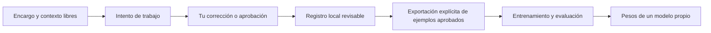

# Unidad

IA privada de uso personal. Núcleo independiente para conectarlo a productos e
interfaces distintos, conservar contexto y avanzar hacia un trabajador digital.
Unidad funciona localmente con Python. El núcleo usa NumPy; el nuevo modelo
conversacional usa PyTorch y un tokenizador propio. No requiere Hormiga-X,
una API de IA ni pesos preentrenados.

Las [órdenes del creador](ORDENES_USUARIO.md) están adjuntas al proyecto. Definen
el objetivo de Unidad y distinguen lo realizado de lo pendiente. Las instrucciones
para quienes modifiquen el código están en [AGENTS.md](AGENTS.md).

**Estado: núcleo conectable con modelos experimentales.**
Ya puede ejecutar operaciones y flujos definidos por el producto, usando las
herramientas que ese producto le proporciona. Los modelos actuales todavía no
comprenden encargos abiertos ni planifican el trabajo de forma competente.
Una red pequeña aprende una tarea concreta; una inteligencia que resuelva encargos
abiertos necesita capacidades y pruebas adicionales. No hemos replicado a una
persona ni su forma completa de pensar.

## Qué contiene

- Un especialista de atención, entrenado desde pesos aleatorios y separado de
  Hormiga-X con su evidencia original. Predice una métrica numérica, no creatividad.
- Un modelo de lenguaje pequeño con entrenamiento propio. Su demostración sirve
  para comprobar que cambian los pesos y se puede generar texto; no demuestra
  comprensión ni calidad conversacional.
- Un Transformer conversacional nuevo, de 1.088.256 parámetros, inicializado
  desde pesos aleatorios. Su primera etapa aprende respuestas breves en español
  con ejemplos públicos y sintéticos identificados. Permite entrenamiento en
  segundo plano, checkpoints y reanudación; su calidad debe comprobarse por
  separado de las pruebas del código.
- Un registro local de encargos, intentos y correcciones en texto libre. No impone
  categorías de personalidad. Permite preparar ejemplos aprobados para entrenar,
  sin confundir memoria con aprendizaje de parámetros.
- Un núcleo Python común para CLI y HTTP, con los pesos incluidos en el paquete.
  Cada «cuerpo» conecta sus herramientas y su memoria; varios cuerpos pueden
  compartir memoria si su configuración lo solicita expresamente.
- Ejecución de flujos explícitos: por ejemplo, generar con un modelo y pasar el
  resultado a una herramienta del producto. Esto comprueba la conexión y la
  ejecución; la calidad del texto sigue siendo la del modelo experimental.

## Instalar

Python 3.11 o posterior:

```bash
python3 -m venv .venv
source .venv/bin/activate
python -m pip install -e .
unidad --help
python -m unittest discover -s tests -v
```

El paquete también se puede usar con `python -m ia_propia` después de instalarlo.
`ia_propia` es el nombre interno del paquete; el comando público es `unidad`.
El comando anterior `ia-propia` se conserva como alias. Cambiar el nombre del
proyecto conserva los pesos y las identidades de los modelos ya entrenados.
Los datos personales van en `private/`, excluido de Git. Los artefactos de `models/`
y textos de `examples/` son demostraciones identificadas, no datos personales.
Los modelos que entrenes con tus propios textos también deben guardarse en
`local-models/` o `private/`: pueden memorizar fragmentos del corpus. Si eliges
otra ruta, la exclusión de Git puede dejar de aplicar. Los permisos locales
no son cifrado.

## Primeros pasos

Para el nuevo modelo de conversación, instala las dependencias CPU:

```bash
python -m pip install torch==2.8.0 --index-url https://download.pytorch.org/whl/cpu
python -m pip install -e '.[conversation]'
```

La [guía de entrenamiento conversacional](docs/conversation.md) explica cómo
preparar datos, empezar, comprobar el progreso, guardar un modelo y reanudar.
Hay una [instantánea experimental guardada](models/conversation-basic-v1/README.md)
con pesos, configuración y tokenizador:

```bash
unidad conversation chat --model models/conversation-basic-v1 \
  --message "Hola, ¿cómo empezamos?" --max-new-tokens 64 --seed 42
unidad conversation status --run-dir private/conversation/runs/basic-v1
```

La consulta de estado corresponde al entorno donde se inició el trabajo; una
clonación nueva tiene los pesos guardados, pero no un entrenador en ejecución.
El primer corpus básico combina 120 ejemplos inventados con 1.087 respuestas
públicas revisadas de OASST1: 965 registros de entrenamiento, 115 de validación
y 127 reservados para prueba, separados por familia de conversación. Los textos
de este chat y las órdenes del creador no se utilizaron como corpus personal.

El estilo solicitado —confidente, cercano y que conecte puntos— orienta los
ejemplos y el contexto del modelo; eso todavía no demuestra que lo haya aprendido.
La [evidencia de esta etapa](docs/unidad-conversation-validation-v0.3.0.json)
registra pesos, métricas y respuestas reales, sin reemplazar su texto por respuestas
de otra IA. El presupuesto de entrenamiento de 24 horas es un máximo; el proceso
puede parar antes si deja de mejorar o si el entorno se detiene.
Unidad 0.3.0 pasó 139 pruebas con las dependencias conversacionales. También
se comprobó una instalación del paquete fuera del repositorio, con Python y HTTP
usando el mismo modelo entre dos cuerpos. Las respuestas de la instantánea
todavía contienen errores y repeticiones: estas pruebas acreditan el código
y la integración, no un habla competente.

La versión 0.4 añade continuación entre etapas con `--initial-model`. La primera
corrida se detuvo al estancarse; la segunda amplía el corpus a 14.207 registros
y conserva sus mejores pesos y el mismo tokenizador. La ampliación mantiene
las familias reservadas y usa el presupuesto restante de las 24 horas originales.
El [registro de progresión](docs/unidad-conversation-progression-v0.4.0.json)
conserva la comparación y el estado observado. Esta etapa sigue siendo experimental.
Su [instantánea exportada](models/conversation-spanish-v2/README.md) se puede
usar desde los productos sin instalar el corpus. Unidad 0.4 pasó 152 pruebas
conversacionales y técnicas; sus respuestas todavía requieren mejoras.
La segunda etapa fue preparada y arrancada mediante comandos explícitos.
Unidad todavía no decide sola qué aprender ni modifica su código.

```bash
unidad conversation chat --model models/conversation-spanish-v2 \
  --message "Hola, ¿cómo empezamos?" --max-new-tokens 64 --seed 42
unidad conversation status --run-dir private/conversation/runs/expanded-v1
```

La versión 0.5 conecta el interior del proyecto mediante un contrato común de
mensajes, límites y parámetros, y un `ConversationEngine` compartido por la consola,
el cerebro y la evaluación. El entrenamiento exporta los mismos pesos, configuración
y tokenizador que consume ese motor. Se conserva un único comportamiento de
inferencia en todos esos caminos.

La siguiente etapa prioriza diálogos cortos con contexto completo. Las ventanas
deslizantes de entrenamiento conservan texto anterior y enseñan cada token de
la respuesta final una sola vez. La batería de desarrollo contiene 28 casos
en 14 pares que cambian la petición actual, con candidatos intercambiados;
también conserva las respuestas reales para revisión humana:

```bash
unidad conversation assess --model models/conversation-spanish-v2 \
  --cases examples/conversation-evaluation.json \
  --output private/conversation/development-report.json
```

Este comando no entrena, no evalúa el test reservado y no finaliza una corrida.
Las probabilidades de candidatos son un diagnóstico: deben revisarse junto con
lo que el modelo realmente dice. Las respuestas actuales siguen siendo
experimentales; conectar el código no acredita comprensión ni programación
autónoma. Pasaron 174 pruebas y se verificó el mismo resultado desde consola,
Python y HTTP en una instalación externa. El
[registro de esta integración](docs/unidad-conversation-cohesion-v0.5.0.json)
conserva pruebas, datos, procedencia y las respuestas defectuosas observadas.

La etapa concentrada se pausó cuando empezó a sobreajustarse. Se conserva su
[mejor instantánea experimental](models/conversation-context-v3/README.md),
y la siguiente etapa combina 5.608 diálogos breves con un ritmo de aprendizaje
menor. Usa el tiempo restante del mismo presupuesto original. La
[guía de conversación](docs/conversation.md) explica ambos recorridos.

```bash
unidad conversation chat --model models/conversation-context-v3 \
  --message "Hola." --max-new-tokens 64 --seed 42
unidad conversation status --run-dir private/conversation/runs/balanced-short-v1
```

También se conserva una [instantánea de bases conversacionales](models/conversation-basics-v4/README.md)
con respuestas y errores documentados. Sigue siendo experimental: los saludos
han mejorado, pero la conversación libre todavía confunde identidades y datos.
Puedes probarla en una sesión de terminal con historial temporal:

```bash
unidad conversation converse --model models/conversation-basics-v4 \
  --temperature 0 --max-new-tokens 32
```

Se adaptó el aprendizaje para evitar calcular salidas sin supervisión. En la
CPU disponible, la [comparación medida](docs/unidad-learning-optimization-v1.json)
redujo un 13,5 % el tiempo por paso y conservó la inferencia. La siguiente etapa
reduce repeticiones de ejemplos fáciles y añade diversidad de textos y
correcciones. El [registro de aprendizaje](docs/unidad-learning-curriculum-v2.json)
conserva la comparación de respuestas y la nueva etapa: las correcciones y los
hechos de conversación libre siguen fallando. Pasaron 277 pruebas técnicas;
mejorar su conversación debe comprobarse por separado. La
[guía](docs/conversation.md) explica cómo activar el nuevo modo de entrenamiento.

La versión 0.5.2 añade una política opcional de práctica adaptativa: reutiliza
las pérdidas de `train` para dar más prioridad a lo difícil, con repaso y límites
de prioridad. Se actualiza por bloques cortos y guarda ese estado para reanudar
exactamente. Los casos de validación y test no ajustan esas prioridades. La
[guía de configuración](docs/conversation.md#adaptar-la-práctica-a-lo-que-todavía-cuesta)
explica la mezcla. En la [comparación controlada](docs/unidad-adaptive-learning-v0.5.2.json),
la configuración adaptativa conservó mejor algunos cambios de nombre, pero
empeoró la validación y la copia literal. Sigue desactivada por defecto; se
conservan los pesos anteriores y no se afirma que esta política haya acortado
el tiempo necesario para aprender a conversar.

La versión 0.6.0 añade una etapa previa de lenguaje: `objective="causal_lm"`
aprende los tokens de documentos de español con procedencia y particiones
propias. Después puede ajustarse el mismo modelo con conversaciones, conservando
sus pesos y tokenizador propios. La [guía de preentrenamiento](docs/language-pretraining.md)
explica los formatos, la reanudación y una configuración nativa de 6.967.296
parámetros con contexto de 512 tokens. Pasaron 287 pruebas técnicas; disponer de
esta ruta de aprendizaje no demuestra que el nuevo modelo converse bien.

La [instantánea v5](models/conversation-basics-v5/README.md) conserva una mejora
experimental: 13 respuestas completas de 22 turnos de desarrollo, frente a 6
del padre. Aún falla al recuperar ciudades y puede repetir sílabas. Para probarla:

```bash
unidad conversation converse --model models/conversation-basics-v5 \
  --temperature 0 --max-new-tokens 32
```

La [instantánea experimental v6](models/conversation-basics-v6/README.md)
conserva otra etapa con más repaso de español público y actualizaciones más
pequeñas. Obtuvo 15 respuestas completas de los mismos 22 turnos de desarrollo;
siguen fallando las ciudades, algunos títulos y una pregunta sobre un dato
desconocido. La etapa terminó y conserva el paso 600 seleccionado por validación.
El [informe de refinamiento](docs/unidad-learning-refinement-v0.5.2.json)
registra el cambio conjunto de currículo y tasa de aprendizaje. Son casos de
desarrollo conocidos, no una prueba nueva de conversación general. Para probar
este candidato, usa `--model models/conversation-basics-v6` en el comando anterior.

También se compararon señales directas de aprendizaje de atención y selección
de datos del diálogo. La segunda prueba elevó la copia literal de 37 a 50 casos
exactos de 89 frente al control experimental ya entrenado, sin repetirlo.
Quedó por debajo de v6 en conversación libre, por lo que se conserva como
investigación y no modifica el modelo usable. El [diagnóstico de aprendizaje](docs/unidad-copy-learning-diagnostics-v1.json)
registra las dos pruebas, sus resultados y los cambios descartados.

El núcleo funciona también desde una instalación del paquete fuera del repositorio:

```bash
unidad brain capabilities --body mi-producto --state-dir private/brain
```

Para integrarlo en Python, servir su API HTTP o conectar herramientas, sigue
[la guía del cerebro y sus cuerpos](docs/brain.md). El ejemplo
[dos productos](examples/brain_in_two_products.py) usa el mismo núcleo con dos
conjuntos de herramientas. Ninguno llama a otra IA.

Unidad 0.2.0 pasó 86 pruebas, incluida la ejecución de un modelo hacia una
herramienta y el aislamiento entre productos. También se comprobó el paquete
instalado fuera del repositorio. La evidencia está en
[el registro de validación del núcleo](docs/unidad-brain-validation-v0.2.0.json).

El registro de encargos también conserva su interfaz anterior:

```bash
unidad init --workspace private/default
unidad task add --workspace private/default \
  --goal "Describe aquí un trabajo concreto" \
  --context "Qué importa hoy, fuentes disponibles y resultado deseado"
unidad task list --workspace private/default
```

El especialista ya guardado se puede reproducir sin entrenarlo de nuevo:

```bash
unidad trend predict --model models/attention-v1.json \
  --input examples/attention-observations.json \
  --as-of 2024-10-16T00:00:00Z --historical
```

Con las 30 capturas iniciales, su error en test todavía supera el de conservar
el último valor. El resultado está conservado en el informe original.

También hay un modelo de lenguaje ya entrenado con los diez textos inventados
de demostración, con 2.903 parámetros. Puedes probar su generación:

```bash
unidad language generate --model models/language-demo.json \
  --prompt "Una tarea " --length 160 --seed 42 --temperature 0.8
```

Su texto todavía contiene palabras sin sentido. Los pesos y resultados
comprueban un entrenamiento pequeño; no acreditan capacidad para resolver
encargos. La verificación inicial está en
[el registro de Unidad 0.1.0](docs/unidad-validation-v0.1.0.json).
El [registro inicial](docs/validation-v0.1.0.json) conserva la primera verificación,
realizada antes de elegir el nombre.

La evaluación del lenguaje conserva sólo el estado recurrente necesario cuando
no calcula gradientes, reduciendo memoria temporal. `unidad task list` devuelve
resúmenes; `unidad task show` permite consultar un historial completo. Las
[mediciones de memoria](docs/language-optimization.md) conservan el resultado
y sus límites; los pesos entrenados no cambiaron.

El registro guarda encargos; guardarlos no inicia un flujo. Los intentos pueden ser
trabajos tuyos o de un asistente que tú revisas. Una corrección actualiza el
contexto registrado; para cambiar pesos hay que exportar ejemplos aprobados y
entrenar expresamente. No usamos este chat como corpus automáticamente.

Los comandos y límites están explicados en [el espacio de trabajo](docs/workspace.md),
[el modelo de lenguaje](docs/language.md) y [el especialista de atención](docs/attention.md).
La separación de Hormiga-X se documenta en [procedencia](docs/provenance.md).



El núcleo puede ejecutar una secuencia de operaciones suministrada por el
producto. Convertir un encargo libre en un plan útil y comprobar su calidad
sigue pendiente; se evaluará sobre encargos reales.

## Hacia un trabajador digital

La mejora del modelo se comprobará sobre encargos reales del usuario:
qué resultado necesita, qué información puede usar y cómo sabremos que terminó.
A partir de ahí se podrán evaluar las herramientas conectadas y tareas completas.
La capacidad de ejecutar acciones y la calidad del modelo deben demostrarse por
separado; generar texto no basta para acreditar que hizo el trabajo.

Las conexiones ejecutan únicamente herramientas registradas por quien integra
el producto. No se obtiene acceso a cuentas al guardar un contexto. El
entrenamiento y las exportaciones se solicitan con comandos explícitos.
