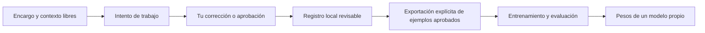

# Unidad

IA privada de uso personal. Núcleo independiente para conectarlo a productos e
interfaces distintos, conservar contexto y avanzar hacia un trabajador digital.
Unidad usa Python y NumPy, funciona localmente y no requiere Hormiga-X,
una API de IA ni pesos preentrenados.

Las [órdenes del creador](ORDENES_USUARIO.md) están adjuntas al proyecto. Definen
el objetivo de Unidad y distinguen lo realizado de lo pendiente. Las instrucciones
para quienes modifiquen el código están en [AGENTS.md](AGENTS.md).

**Estado: núcleo conectable con modelos experimentales.**
Ya puede ejecutar operaciones y flujos definidos por el producto, usando las
herramientas que ese producto le proporciona. Los modelos actuales todavía no
comprenden encargos abiertos ni planifican el trabajo de forma competente.
Una red pequeña aprende una tarea concreta; una inteligencia que resuelva encargos
abiertos necesita capacidades y pruebas adicionales. No hemos replicado a una
persona ni su forma completa de pensar.

## Qué contiene

- Un especialista de atención, entrenado desde pesos aleatorios y separado de
  Hormiga-X con su evidencia original. Predice una métrica numérica, no creatividad.
- Un modelo de lenguaje pequeño con entrenamiento propio. Su demostración sirve
  para comprobar que cambian los pesos y se puede generar texto; no demuestra
  comprensión ni calidad conversacional.
- Un registro local de encargos, intentos y correcciones en texto libre. No impone
  categorías de personalidad. Permite preparar ejemplos aprobados para entrenar,
  sin confundir memoria con aprendizaje de parámetros.
- Un núcleo Python común para CLI y HTTP, con los pesos incluidos en el paquete.
  Cada «cuerpo» conecta sus herramientas y su memoria; varios cuerpos pueden
  compartir memoria si su configuración lo solicita expresamente.
- Ejecución de flujos explícitos: por ejemplo, generar con un modelo y pasar el
  resultado a una herramienta del producto. Esto comprueba la conexión y la
  ejecución; la calidad del texto sigue siendo la del modelo experimental.

## Instalar

Python 3.11 o posterior:

```bash
python3 -m venv .venv
source .venv/bin/activate
python -m pip install -e .
unidad --help
python -m unittest discover -s tests -v
```

El paquete también se puede usar con `python -m ia_propia` después de instalarlo.
`ia_propia` es el nombre interno del paquete; el comando público es `unidad`.
El comando anterior `ia-propia` se conserva como alias. Cambiar el nombre del
proyecto conserva los pesos y las identidades de los modelos ya entrenados.
Los datos personales van en `private/`, excluido de Git. Los artefactos de `models/`
y textos de `examples/` son demostraciones identificadas, no datos personales.
Los modelos que entrenes con tus propios textos también deben guardarse en
`local-models/` o `private/`: pueden memorizar fragmentos del corpus. Si eliges
otra ruta, la exclusión de Git puede dejar de aplicar. Los permisos locales
no son cifrado.

## Primeros pasos

El núcleo funciona también desde una instalación del paquete fuera del repositorio:

```bash
unidad brain capabilities --body mi-producto --state-dir private/brain
```

Para integrarlo en Python, servir su API HTTP o conectar herramientas, sigue
[la guía del cerebro y sus cuerpos](docs/brain.md). El ejemplo
[dos productos](examples/brain_in_two_products.py) usa el mismo núcleo con dos
conjuntos de herramientas. Ninguno llama a otra IA.

Unidad 0.2.0 pasó 86 pruebas, incluida la ejecución de un modelo hacia una
herramienta y el aislamiento entre productos. También se comprobó el paquete
instalado fuera del repositorio. La evidencia está en
[el registro de validación del núcleo](docs/unidad-brain-validation-v0.2.0.json).

El registro de encargos también conserva su interfaz anterior:

```bash
unidad init --workspace private/default
unidad task add --workspace private/default \
  --goal "Describe aquí un trabajo concreto" \
  --context "Qué importa hoy, fuentes disponibles y resultado deseado"
unidad task list --workspace private/default
```

El especialista ya guardado se puede reproducir sin entrenarlo de nuevo:

```bash
unidad trend predict --model models/attention-v1.json \
  --input examples/attention-observations.json \
  --as-of 2024-10-16T00:00:00Z --historical
```

Con las 30 capturas iniciales, su error en test todavía supera el de conservar
el último valor. El resultado está conservado en el informe original.

También hay un modelo de lenguaje ya entrenado con los diez textos inventados
de demostración, con 2.903 parámetros. Puedes probar su generación:

```bash
unidad language generate --model models/language-demo.json \
  --prompt "Una tarea " --length 160 --seed 42 --temperature 0.8
```

Su texto todavía contiene palabras sin sentido. Los pesos y resultados
comprueban un entrenamiento pequeño; no acreditan capacidad para resolver
encargos. La verificación inicial está en
[el registro de Unidad 0.1.0](docs/unidad-validation-v0.1.0.json).
El [registro inicial](docs/validation-v0.1.0.json) conserva la primera verificación,
realizada antes de elegir el nombre.

La evaluación del lenguaje conserva sólo el estado recurrente necesario cuando
no calcula gradientes, reduciendo memoria temporal. `unidad task list` devuelve
resúmenes; `unidad task show` permite consultar un historial completo. Las
[mediciones de memoria](docs/language-optimization.md) conservan el resultado
y sus límites; los pesos entrenados no cambiaron.

El registro guarda encargos; guardarlos no inicia un flujo. Los intentos pueden ser
trabajos tuyos o de un asistente que tú revisas. Una corrección actualiza el
contexto registrado; para cambiar pesos hay que exportar ejemplos aprobados y
entrenar expresamente. No usamos este chat como corpus automáticamente.

Los comandos y límites están explicados en [el espacio de trabajo](docs/workspace.md),
[el modelo de lenguaje](docs/language.md) y [el especialista de atención](docs/attention.md).
La separación de Hormiga-X se documenta en [procedencia](docs/provenance.md).



El núcleo puede ejecutar una secuencia de operaciones suministrada por el
producto. Convertir un encargo libre en un plan útil y comprobar su calidad
sigue pendiente; se evaluará sobre encargos reales.

## Hacia un trabajador digital

La mejora del modelo se comprobará sobre encargos reales del usuario:
qué resultado necesita, qué información puede usar y cómo sabremos que terminó.
A partir de ahí se podrán evaluar las herramientas conectadas y tareas completas.
La capacidad de ejecutar acciones y la calidad del modelo deben demostrarse por
separado; generar texto no basta para acreditar que hizo el trabajo.

Las conexiones ejecutan únicamente herramientas registradas por quien integra
el producto. No se obtiene acceso a cuentas al guardar un contexto. El
entrenamiento y las exportaciones se solicitan con comandos explícitos.
