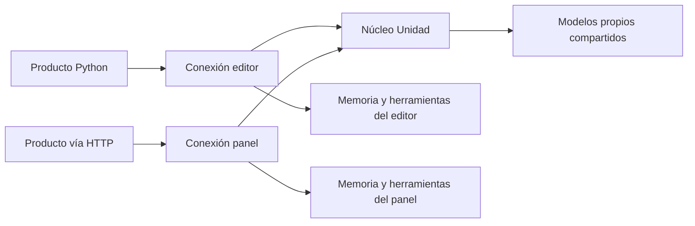

# Un cerebro, varios cuerpos

Unidad 0.2.0 separa el núcleo de los productos que lo usan. Una instancia de
`Brain` carga una vez los dos modelos propios; sus conexiones usan esos mismos
pesos. Python, CLI y HTTP envían el mismo contrato de operaciones. El paquete
incluye los artefactos entrenados: no depende del directorio `models/` ni llama a
una API de IA.



«Cuerpo» significa una conexión configurada por el producto: su identificador,
sus herramientas y su ámbito de memoria. No representa una categoría de
personalidad. Los objetivos y las correcciones siguen siendo texto libre.

## Integrarlo en Python

Después de instalar el paquete:

```python
from pathlib import Path
from ia_propia.brain import Brain, Tool

def save_draft(arguments):
    # Aquí se conecta la función real de tu producto.
    text = arguments["text"]
    if not isinstance(text, str):
        raise ValueError("Se necesita texto")
    Path("private/draft.txt").write_text(text, encoding="utf-8")
    return {"saved": True}

brain = Brain(state_dir=Path("private/brain"))
editor = brain.connect("editor", tools=[Tool("draft.save", save_draft)])
panel = brain.connect("panel")

response = editor.request({
    "schemaVersion": 1,
    "operation": "language.generate",
    "input": {"prompt": "Una tarea ", "length": 160,
              "seed": 42, "temperature": 0.8},
})
print(response)
```

Cada conexión sólo encuentra las herramientas registradas para ella. El producto
debe validar los argumentos de sus handlers y limitar las acciones que ofrecen.
Esos handlers son código Python del producto: no se ejecutan dentro de un sandbox.
Una petición no puede registrar funciones, importar módulos ni elegir rutas de
modelos o de memoria.

`Tool` admite un `validator` opcional para comprobar argumentos antes de llamar
al handler. Ese validador debe ser puro: puede llamarse durante la revisión del
flujo y de nuevo antes de ejecutarlo.

El ejemplo ejecutable conecta dos productos al mismo `Brain`, usa un cliente
Python y otro HTTP y guarda el resultado del modelo a través de herramientas:

```bash
python examples/brain_in_two_products.py
# Para conservar los archivos ficticios de la demostración:
python examples/brain_in_two_products.py --output-dir private/two-products-demo
```

## Contrato común

La petición contiene `schemaVersion: 1`, `operation` e `input`. Acepta también
`requestId` para correlacionar la respuesta y un objeto `context` como metadatos
libres. El contexto no cambia los permisos, no modifica los pesos y no se
interpreta como un plan. Para registrar contexto duradero usa `memory.task.add`;
para condicionar la generación actual utiliza `input.prompt`.

La respuesta incluye `requestId`, `bodyId`, `operation`, `status` y el resultado
o un error con `code` y `message`. `workerCapabilityValidated` permanece en
`false`: ejecutar pasos no demuestra capacidad para resolver encargos abiertos.

| Operación | Entrada |
| --- | --- |
| `language.generate` | `prompt`, `length`, `seed`, `temperature`; admite valores por defecto. |
| `attention.forecast` | `observations` como JSON; opcionales `signal_id`, `as_of` en milisegundos, `historical`, `source`, `metric`. |
| `memory.task.add` | `goal` y `context` como texto. |
| `memory.task.list` | Objeto vacío. |
| `memory.task.show` | `task_id`. |
| `memory.task.attempt` | `task_id`, `text` y opcional `evidence` como lista de referencias. |
| `memory.task.feedback` | `task_id`, `attempt_id`, `text`, `accepted` booleano. |
| `memory.task.status` | Objeto vacío. |
| `tool.call` | `name` registrado en esa conexión y `arguments` como objeto. |
| `workflow.run` | `steps`, una lista ordenada de hasta 16 operaciones. |

`session.capabilities()` y el endpoint HTTP de capacidades describen lo que está
conectado, las identidades de los modelos y sus límites. Las observaciones de
atención conservan las validaciones de procedencia pública y temporalidad del
especialista; no basta con enviar una lista de números. `historical: true`
permite reproducir evidencia antigua, sin convertirla en pronóstico en vivo.

El JSON se limita a 262.144 bytes por petición, profundidad 16 y 20.000 nodos.
Se rechazan claves duplicadas, números no finitos y campos no admitidos. Las
respuestas tienen un límite de 1.048.576 bytes. `requestId` identifica la llamada;
no evita repetir efectos si el cliente vuelve a enviarla.

## Ejecutar pasos de un producto

El producto suministra un flujo explícito. Una referencia obtiene un dato del
resultado de un paso anterior, recorriendo claves de objetos o índices de listas:

```python
response = editor.request({
    "schemaVersion": 1,
    "operation": "workflow.run",
    "input": {"steps": [
        {"id": "draft", "operation": "language.generate",
         "input": {"prompt": "Una tarea ", "length": 160, "seed": 42}},
        {"id": "save", "operation": "tool.call", "input": {
            "name": "draft.save",
            "arguments": {"text": {"$ref": "draft.continuation"}}}},
    ]},
})
```

Antes de ejecutar se comprueban estructura, operaciones, herramientas y
dependencias entre pasos. Los valores obtenidos de referencias se validan cuando
existen. Si un paso falla, la respuesta informa los pasos anteriores completados
y `effectsRolledBack: false`. Una herramienta externa podría haber hecho parte
de su trabajo antes de fallar; el núcleo no promete deshacerlo. Las referencias
no evalúan código ni expresiones.

Si los resultados acumulados exceden el presupuesto de respuesta, el flujo se
detiene y conserva un resumen de los identificadores completados, omitiendo sus
resultados grandes. No se borran los efectos ya realizados.

El modelo de caracteres todavía produce texto defectuoso. Este ejemplo prueba
que el modelo está conectado a una acción del producto; no prueba calidad del
borrador ni planificación aprendida. Comprender un encargo libre y diseñar esos
pasos seguirá necesitando mejoras y evaluación del modelo.

## Memoria entre cuerpos

Por defecto, `editor` y `panel` tienen registros separados, incluso si comparten
la misma instancia del núcleo. Para compartir encargos entre dos productos del
mismo creador, la aplicación lo configura expresamente:

```python
editor = brain.connect("editor", memory_scope="creator")
panel = brain.connect("panel", memory_scope="creator")
```

El cliente HTTP no puede cambiar ese ámbito. Los directorios se derivan de
identificadores mediante SHA-256; los identificadores no son rutas. El ámbito
separa registros, pero los pesos siguen siendo comunes. Un modelo entrenado con
textos personales podría reproducir fragmentos en otros cuerpos; aislar registros
no elimina lo aprendido en esos pesos. La demostración incluida usa textos
inventados, y no entrena con este chat.

## Conectarlo mediante HTTP

La CLI sirve una conexión fija sin herramientas externas. Para conectar las
funciones reales de un producto, crea su sesión en Python y pásala a
`create_server(session, token=...)`, como en el ejemplo de dos productos.

```bash
export UNIDAD_API_TOKEN="$(python -c 'import secrets; print(secrets.token_urlsafe(32))')"
unidad brain serve --body mi-producto --state-dir private/brain --port 8765
```

El servidor escucha en `127.0.0.1` por defecto. Todas las rutas requieren la
credencial Bearer, incluso salud y capacidades. La credencial se mantiene en el
servidor de tu producto; el adaptador no ofrece CORS para exponerla al navegador.
Para acceso remoto, tu infraestructura debe aportar HTTPS y el control de acceso.

```bash
curl -s http://127.0.0.1:8765/v1/capabilities \
  -H "Authorization: Bearer $UNIDAD_API_TOKEN"

curl -s http://127.0.0.1:8765/v1/requests \
  -H "Authorization: Bearer $UNIDAD_API_TOKEN" \
  -H 'Content-Type: application/json' \
  --data '{"schemaVersion":1,"operation":"language.generate","input":{"prompt":"Una tarea ","length":160,"seed":42}}'
```

Endpoints: `GET /health`, `GET /v1/capabilities` y `POST /v1/requests`.
POST exige `Content-Length`; no acepta transferencia por bloques ni contenido
comprimido. El servidor no escribe peticiones ni credenciales en sus logs.

La misma petición puede enviarse desde la CLI:

```bash
printf '%s' '{"schemaVersion":1,"operation":"memory.task.list","input":{}}' \
  | unidad brain call --body mi-producto --input -
```

CLI y HTTP también admiten configuración de rutas de modelos propios mediante
`--language-model` y `--attention-model`; esa configuración pertenece al anfitrión,
no a la petición. No hay descarga ni sustitución automática por otro modelo.
