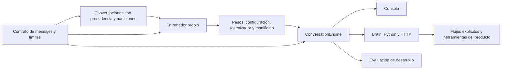

# Conversación en español desde pesos propios

Unidad incorpora un Transformer pequeño para aprender a responder en español.
Sus pesos comienzan aleatorios; el código no descarga pesos preentrenados ni
consulta otra IA para generar las respuestas. Es una primera etapa experimental:
tener un checkpoint o reducir la pérdida no demuestra conversación competente,
comprensión general ni capacidad para trabajar o programarse por sí misma.

## Un recorrido compartido para el código

`conversation/contract.py` define roles, tokens de control, límites, contexto
predeterminado y parámetros de generación. La importación de datos, el tokenizador
y la inferencia usan esas mismas constantes. `ConversationEngine` carga un
artefacto local una vez y ofrece generación y puntuación sobre los mismos pesos.
CLI, `Brain` y evaluación llaman a ese motor; sus adaptadores no implementan
generadores alternativos ni cambian el modelo a partir de una petición.



La conexión se hace a través de contratos pequeños y operaciones explícitas.
Las redes de lenguaje anteriores y el especialista conservan sus parámetros y
adaptadores. No se mezclan sus pesos ni se establece comunicación entre cada
par de módulos. El cerebro coordina las operaciones suministradas por el producto.

```python
from ia_propia.conversation.runtime import ConversationEngine

engine = ConversationEngine("models/conversation-spanish-v2")
reply = engine.reply([{"role": "user", "content": "Hola."}])
score = engine.score_reply([{"role": "user", "content": "Hola."}], "Hola, ¿cómo estás?")
```

`score_reply` recibe un candidato de desarrollo; no lo usa como respuesta ni
entrena con él. La identidad y el manifiesto se pueden consultar con
`engine.model_id` y `engine.manifest`. Una instancia comparte carga y pesos,
y cada llamada aporta su contexto explícito.

La configuración básica tiene **1.088.256 parámetros** cuando el vocabulario BPE
alcanza 2.048 tokens: dimensión 128, cuatro capas, cuatro cabezas y contexto de
256 tokens. Usa atención causal, normalización previa, GELU y una salida que
comparte pesos con los embeddings. El tokenizador se ajusta sólo con `train`.
Si un corpus pequeño produce un vocabulario menor, cambia el número de parámetros;
el artefacto conserva la configuración y el recuento reales.

## Instalar para CPU

Desde la raíz del repositorio, con Python 3.11 o posterior:

```bash
python3 -m venv .venv
source .venv/bin/activate
python -m pip install torch==2.8.0 --index-url https://download.pytorch.org/whl/cpu
python -m pip install -e '.[conversation]'
unidad conversation --help
```

Las dependencias opcionales son PyTorch 2.8.0, tokenizers 0.22.2 y safetensors
0.7.0. La instalación CPU evita exigir una GPU. La memoria, el número de hilos y
la velocidad disponibles siguen limitando el entrenamiento. El controlador de
trabajos actual usa mecanismos de Linux para bloqueo y seguimiento de procesos.
El núcleo anterior funciona sin estas dependencias si no se configura el nuevo
modelo conversacional.

## Conversar en terminal

La consola interactiva carga el mismo `ConversationEngine` que los productos:

```bash
unidad conversation converse --model models/conversation-context-v3 \
  --temperature 0 --max-new-tokens 64
```

Escribe un mensaje por línea. `/reiniciar` borra el historial de esa sesión y
`/salir` termina. El historial contiene tus mensajes y las respuestas realmente
generadas; permanece en RAM y no entrena el modelo. La consola muestra el texto
íntegro y avisa cuando el contexto finito obliga a recortar mensajes anteriores.
Una respuesta vacía o inválida no se reemplaza por una frase inventada.
La calidad depende de los pesos que elijas; esta interfaz no añade comprensión.

## Ahorrar cálculo durante el aprendizaje

Una nueva etapa puede usar `"projection_mode": "supervised"` en el JSON de
entrenamiento. El Transformer sigue leyendo todo el contexto; la salida sobre el
vocabulario se calcula sólo en las posiciones que enseñan la respuesta final.
Los tokens anteriores siguen aportando contexto y recibiendo gradientes.

La [medición de esta optimización](unidad-learning-optimization-v1.json) comparó
96 pasos completos de AdamW por camino sobre los mismos lotes de entrenamiento:
en esta CPU de cuatro núcleos, el tiempo bajó un 13,5 % y el máximo de memoria del
proceso un 4,7 %. No es una estimación de cuánto falta para aprender a conversar.
Las respuestas de los pesos fijos se conservaron; las diferencias numéricas de
gradientes son pequeñas, por lo que las trayectorias de entrenamiento entre
ambos modos no se declaran idénticas.

```json
{
  "projection_mode": "supervised",
  "loss_reduction": "sequence_mean",
  "torch_threads": 4
}
```

Si se omite `projection_mode`, permanece el cálculo anterior. Una reanudación
conserva el modo guardado; para cambiarlo, empieza otra etapa con
`--initial-model`. La inferencia y el formato de los pesos se conservan.

### Entrenar con BF16 en CPU

Una etapa nueva puede activar la precisión BF16 durante el forward:

```json
{
  "train_precision": "cpu_bfloat16",
  "projection_mode": "supervised",
  "loss_reduction": "token_mean",
  "torch_threads": 4
}
```

La proyección del modelo usa autocast BF16. La pérdida recibe logits FP32 fuera
de autocast; pesos, gradientes, Adam, validación y artefactos se conservan en
FP32. La inferencia continúa usando el motor común. Al omitir `train_precision`,
se conserva el entrenamiento anterior y sus campos de configuración y estado.

En esta CPU, dos comparaciones cortas con orden invertido midieron **0,914 s
frente a 0,501 s por paso completo**, un 45,2 % menos tiempo. Usaron 32 ventanas
fijas de TRAIN, cuatro hilos y el modelo propio de 6.967.296 parámetros. Esto no
estima el rendimiento de todo el corpus ni la calidad de sus conversaciones.
El [informe de precisión](unidad-cpu-bfloat16-v1.json) conserva el alcance y los
controles numéricos, incluida una medición inicial de coseno inválida que fue
rechazada antes de la comparación posterior en FLOAT64.

Una prueba nativa pequeña con dropout verificó exactamente seis pasos continuos
frente a tres, guardado y otros tres: pesos, Adam, scheduler, orden de ejemplos y
RNG coincidieron. También verificó que el modo predeterminado produce el mismo
estado que el código anterior. Esta prueba usa ejemplos ficticios y no acredita
competencia conversacional ni equivalencia de pesos entre FP32 y BF16.

Reanudar exige el mismo modo y la misma configuración local registrada de Torch,
CPU, hilos y opciones de cálculo; el modo BF16 requiere Linux y soporte de la CPU.
El registro detecta cambios en esas opciones, pero no garantiza equivalencia
universal entre máquinas ni cubre todas las variables externas de MKL/oneDNN.
Para cambiar la precisión, exporta el checkpoint seleccionado y comienza una
etapa nueva con `--initial-model`; se reinician Adam y el scheduler.

## Adaptar la práctica a lo que todavía cuesta

Una nueva etapa puede activar el muestreo adaptativo de ventanas de `train`:

```json
{
  "projection_mode": "supervised",
  "loss_reduction": "sequence_mean",
  "adaptive_sampling": {
    "mode": "train_loss_ema",
    "ema_decay": 0.9,
    "exponent": 0.5,
    "coverage": 0.25,
    "min_priority": 0.5,
    "max_priority": 2.0,
    "refresh_every_steps": 64
  }
}
```

El entrenador reutiliza la pérdida media de los tokens de la última respuesta
del asistente, incluido EOS. Registra esa dificultad sólo después de completar
el paso del optimizador; no puntúa de nuevo el corpus para actualizarla. Una
media móvil suaviza las observaciones de cada ventana. Las ventanas aún no
observadas empiezan con prioridad neutra.

El siguiente bloque combina un 25 % de la distribución base con un 75 % de la
distribución de dificultad. Los pesos de procedencia, si se configuran, definen
esa base. Los límites `min_priority` y `max_priority` se aplican antes de
normalizar; con estos valores, la probabilidad relativa a la base queda entre
0,4375 y 3,25. Esto conserva una probabilidad de repaso; no garantiza que cada
ejemplo aparezca en un bloque finito.

Cada bloque tiene como máximo 64 lotes y se consume por completo antes de
actualizar las prioridades. Una época sigue siendo tantas extracciones como
ventanas de entrenamiento. El checkpoint guarda las dificultades, las veces
observadas, el bloque, los cursores y los estados aleatorios. Reanudar conserva
todo ello; cambiar de política exige empezar otra etapa. El registro muestra
cómo cambian la distribución y las extracciones por fuente.

Sin `adaptive_sampling` se conserva el aprendizaje anterior. La validación y
el test mantienen sus ejemplos únicos y nunca actualizan las prioridades.
Una pérdida alta también puede corresponder a ruido o ambigüedad: esta opción
necesita una comparación de respuestas reales antes de afirmar que acelera la
adquisición de conversación.

La [comparación de la versión 0.5.2](unidad-adaptive-learning-v0.5.2.json)
partió de los mismos pesos y usó 384 pasos por variante. La configuración
adaptativa tuvo mayor pérdida de validación y 30 copias literales exactas de 89,
frente a 38 de la política fija. Recuperó mejor algunos nombres en conversación
libre, pero no superó de forma consistente a la instantánea v5. Por eso permanece
como opción experimental desactivada por defecto.

Se conserva también una etapa con prioridad fija, más repaso de español público
y una tasa de aprendizaje menor. Terminó en 1.200 pasos y seleccionó el paso 600
por la validación existente. En los mismos diálogos de desarrollo, el candidato
v6 obtuvo 15 respuestas completas de 22, frente a 13 de v5; ambos completaron
dos de cinco sesiones. Los hechos nuevos y algunas correcciones siguen fallando.
El [informe de refinamiento](unidad-learning-refinement-v0.5.2.json) conserva
pesos, métricas y límites. Cambiaron juntos el currículo y la tasa: la prueba
no permite atribuir el resultado a uno de esos cambios por separado.

El [diagnóstico de copia aprendida](unidad-copy-learning-diagnostics-v1.json)
compara además objetivos auxiliares de atención y selección de tokens del
usuario, empleados sólo al entrenar prototipos privados. Mejoraron parte de la
copia literal, pero ninguno superó la conversación libre global de v6. El
segundo reutilizó el control congelado; no permite comparar velocidades.
Estos prototipos no cambian la arquitectura ni la inferencia del paquete.

## Dar peso a las conversaciones breves

La reducción anterior, `token_mean`, promedia la pérdida de todos los tokens
objetivo. Una respuesta de doscientas palabras pesa más que una corrección breve.
Una nueva etapa puede elegir `"loss_reduction": "sequence_mean"`: calcula la
pérdida media de cada ventana supervisada y después promedia esas ventanas.
Si el diálogo completo cabe en una ventana, cada respuesta final pesa igual.
En diálogos largos la unidad sigue siendo la ventana, no la conversación.

La validación y la elección del mejor checkpoint usan esa misma reducción.
Los informes conservan también `tokenWeightedNll` para distinguir ambas medidas.
No compares directamente el NLL de corpus o reducciones diferentes como prueba
de una mejora conversacional. Los checkpoints anteriores conservan su cálculo
original y una reanudación mantiene la reducción guardada.

El [currículo revisado](../examples/conversation-grounded-curriculum-v2.jsonl)
contiene 12.960 registros ficticios y sus
[límites de autoría](../examples/conversation-grounded-curriculum-v2.review.json).
Las situaciones, correcciones y paráfrasis de un episodio comparten partición;
las habilidades aparecen en todas las particiones con asociaciones diferentes.
El tokenizador se usa para medir longitud, sin cargar pesos ni elegir ejemplos
según las respuestas del modelo. Los generadores escriben datos de entrenamiento;
no participan en la inferencia.

El [preparador de la mezcla](../examples/prepare_grounded_curriculum.py) conserva
los registros y particiones anteriores, limita las familias públicas por un hash
estable y rechaza coincidencias de prompts sintéticos entre particiones. Las
familias públicas históricas con prompts ambiguos se excluyen completas de la
nueva mezcla. Tanto corpus como manifiesto se crean sin sobrescribir evidencia.

## Datos de la primera etapa

[examples/conversation-demo.jsonl](../examples/conversation-demo.jsonl) contiene
120 registros inventados para el proyecto, identificados como
`authored-synthetic`. Son diálogos ficticios de español básico y del estilo
cercano solicitado. Los textos de este chat, el historial personal y
[las órdenes del creador](../ORDENES_USUARIO.md) no se usaron como corpus personal.

La fuente pública es [OpenAssistant/oasst1](https://huggingface.co/datasets/OpenAssistant/oasst1),
licencia Apache-2.0, revisión
`fdf72ae0827c1cda404aff25b6603abec9e3399b`. El importador conserva procedencia,
identificadores, idioma y revisión, y filtra mensajes según sus etiquetas de
revisión. Importa conversaciones en español; los ejemplos sintéticos externos
quedan excluidos. El archivo original y su licencia se conservan junto a los
datos locales. El importador no descarga el corpus.

El [registro de procedencia y resultados](unidad-conversation-validation-v0.3.0.json)
incluye la URL oficial fija, el SHA-256 del archivo original y los conteos de la
importación. La [licencia Apache-2.0 de esa fuente](licenses/OASST1-Apache-2.0.txt)
se conserva en el repositorio. También hay una
[instantánea experimental ya exportada](../models/conversation-basic-v1/README.md)
que puedes probar sin descargar el corpus ni entrenar de nuevo:

```bash
unidad conversation chat --model models/conversation-basic-v1 \
  --message 'Hola, ¿cómo empezamos?' --max-new-tokens 64 --seed 42
```

Si ya tienes el archivo de árboles OASST de esa revisión en la ruta indicada:

```bash
unidad conversation import-oasst \
  --input private/conversation/sources/oasst-ready.trees.jsonl.gz \
  --output private/conversation/oasst-es.jsonl \
  --language es \
  --revision fdf72ae0827c1cda404aff25b6603abec9e3399b
```

El [preparador básico](../examples/prepare_basic_conversations.py) selecciona
hasta 500 familias públicas de diálogos breves, sin bloques de código, conserva
sus splits y elimina diálogos exactamente duplicados. Para preparar el corpus
que usa la etapa básica:

```bash
python examples/prepare_basic_conversations.py \
  --demo examples/conversation-demo.jsonl \
  --oasst-corpus private/conversation/oasst-es.jsonl \
  --human-groups 500 \
  --output private/conversation/basic-es-v1.jsonl
```

La selección realizada con estas fuentes produjo 1.207 registros: 120 sintéticos
del proyecto y 1.087 públicos, con 965 en entrenamiento, 115 en validación y
127 en test. Son registros de conversación; varios pueden pertenecer a la misma
familia. El helper imprime los conteos y el SHA-256 del archivo realmente
producido. Una fuente o revisión diferente puede cambiar esos conteos.

La separación ocurre por familia completa: una conversación y sus continuaciones
permanecen en un solo split. El corpus canónico es JSONL con `id`, `groupId`,
`split`, `source` y `messages`. La carga rechaza IDs repetidos y familias presentes
en varios splits. La procedencia describe los datos; no es texto que se enseñe
al modelo como respuesta.

El helper básico rechaza un archivo de salida existente. El importador OASST
puede reemplazar su salida; para repetir cualquiera de estos pasos elige un nombre
nuevo y conserva intacto el corpus de una corrida que quieras reanudar.
`private/` y `local-models/` están excluidos de Git.

## Entrenar y seguir el proceso

`train` trabaja en primer plano. Esta prueba corta usa los 120 ejemplos ficticios
y un directorio nuevo:

```bash
unidad conversation train \
  --corpus examples/conversation-demo.jsonl \
  --run-dir private/conversation/runs/demo-v1 \
  --budget-seconds 60
```

`start` crea un trabajador local en segundo plano. Para una nueva corrida básica,
guarda este objeto como
`private/conversation/config/basic-training-v2.json`:

```json
{
  "batch_size": 8,
  "learning_rate": 0.0003,
  "weight_decay": 0.01,
  "grad_clip": 1.0,
  "max_epochs": 5000,
  "max_steps": 400000,
  "max_seconds": 86400,
  "validation_every": 100,
  "checkpoint_every": 100,
  "patience": 20,
  "min_delta": 0.0001,
  "seed": 42,
  "warmup_steps": 100,
  "torch_threads": 4
}
```

```bash
unidad conversation start \
  --corpus private/conversation/basic-es-v1.jsonl \
  --run-dir private/conversation/runs/basic-v2 \
  --training-config private/conversation/config/basic-training-v2.json
unidad conversation status --run-dir private/conversation/runs/basic-v2
```

`basic-v1` es el nombre de la primera corrida iniciada en este entorno; se puede
consultar con `status --run-dir private/conversation/runs/basic-v1`. Los comandos
anteriores usan `basic-v2` para iniciar una corrida nueva. Un directorio existente
no se reinicia ni se sobrescribe mediante `start`.

`max_seconds` es el presupuesto total acumulado de esa corrida, limitado a
86.400 segundos. `--budget-seconds` permite acotar una invocación sin reiniciar
ese total. El proceso también puede terminar por límites de épocas o pasos,
por una parada solicitada o por falta de mejora en validación. Entrenar durante
24 horas no obliga a ignorar una validación que empeora.

El estado JSON informa `status`, `reason`, `step`, `epoch`, `elapsedSeconds`,
`lastCheckpoint`, `bestCheckpoint`, `bestValidationNll`, `processAlive` y
`heartbeatAgeSeconds`, cuando están disponibles. `planned` significa iniciado
pero aún en preparación; `running`, que el entrenamiento publicó actividad;
`stopped`, una pausa; `completed`, un límite alcanzado; y `failed`, un error.
Si el estado registrado era `planned` o `running` y el proceso ya no está vivo,
la consulta informa `stale`. Una corrida `stopped`, `completed` o `failed`
conserva ese estado aunque el proceso haya terminado. El estado no sustituye
la comprobación de actividad del proceso.

Cada corrida guarda `status.json`, `events.jsonl`, `worker.log` cuando se usa
segundo plano, y checkpoints con pesos y estado de reanudación. Conserva el
último checkpoint coherente y el elegido por validación. Un error o cierre brusco
puede perder pasos posteriores al último checkpoint completo.

## Dar suficiente frecuencia a las bases

`sampling_weights` es una opción del JSON de entrenamiento. Selecciona ventanas
por su procedencia, con reemplazo, usando factores explícitos. Por ejemplo:

```json
{
  "loss_reduction": "sequence_mean",
  "sampling_weights": [
    {"dataset": "unidad-natural-basics-v2", "factor": 2.0},
    {"dataset": "unidad-natural-basics-v2", "prefixPairs": 1, "factor": 64.0}
  ]
}
```

Las reglas coincidentes se multiplican: aquí una apertura de ese currículo tiene
peso 128 y sus continuaciones peso 2. Las ventanas sin regla tienen peso 1.
Cada regla debe coincidir con al menos una ventana de entrenamiento. La selección
usa `source.dataset` y, si se especifica, `source.prefixPairs`; no inspecciona
respuestas generadas ni modifica la inferencia.

Una época conserva el número de ventanas originales, pero puede repetir algunas
y dejar otras sin visitar. `trainingSampling` informa registros y ventanas únicos,
factores y frecuencias esperadas; los eventos `sampling_epoch` registran las
repeticiones observadas. Reexponer veinte aperturas no crea ejemplos nuevos.
Validación y test mantienen todos sus ejemplos originales, sin sobremuestreo.
La pérdida `sequence_mean` sigue dando el mismo peso a cada ventana del lote.

Los checkpoints guardan el orden seleccionado, su posición y los generadores
aleatorios. Reanudar exige las mismas reglas y el mismo corpus. Si se omite
`sampling_weights`, permanece el recorrido anterior: una permutación de todas
las ventanas por época, sin reemplazo.

Los generadores [de hechos abiertos](../examples/build_open_fact_conversations.py)
y [de conversación básica](../examples/build_natural_basics.py) producen ejemplos
ficticios identificados, usando el tokenizador propio existente. El segundo
conserva prototipos de aperturas sin datos previos; enseña la identidad de Unidad,
nombres desconocidos, presentaciones, correcciones y cambios de intención. Ambos
guardan manifiestos, hashes y particiones. Sus plantillas sólo crean datos de
entrenamiento; el motor conversacional genera cada respuesta desde los pesos.

La frecuencia también debe revisarse cuando un ejemplo deja de aportar
aprendizaje. En una auditoría exclusiva de TRAIN, veinte aperturas tenían un
error muy bajo y aun así recibían el 9,55 % de las muestras esperadas. Una etapa
redujo su multiplicador de 64 a 8. La pérdida baja no garantizó conservar esos
comportamientos al generar; la etapa posterior lo ajusta a 32 mientras aporta
contextos nuevos. Los factores se multiplican por el peso del conjunto, 2 en
este caso. Su efecto en retención y conversación se comprueba por separado.
El [generador de copia literal](../examples/build_literal_copy_conversations.py)
añade nombres, frases, códigos y correcciones ficticias con valores separados
por familia. Enseña a conservar incluso espacios y composición Unicode, sin
añadir reglas de copia al generador de respuestas.

El [currículo natural](unidad-natural-diversity-v2.md) añade ocho formulaciones
por evento y hechos independientes intercalados. El
[generador de recuperación](../examples/build_conversation_recovery.py) cambia
una respuesta anterior por un error ficticio, conservando exactamente los
mensajes del usuario y la respuesta final correcta. El entrenador supervisa
sólo esa respuesta final y EOS; el error permanece como contexto, nunca como
objetivo. Los datos anteriores y sus particiones se conservan. Ninguno de estos
helpers participa en la inferencia.

## Detener y reanudar

```bash
unidad conversation stop --run-dir private/conversation/runs/basic-v2
unidad conversation status --run-dir private/conversation/runs/basic-v2
```

`stop` solicita una parada cooperativa al proceso de esa corrida. Comprueba su
estado hasta que deje de ejecutarse y tenga un checkpoint antes de reanudar:

```bash
unidad conversation resume \
  --corpus private/conversation/basic-es-v1.jsonl \
  --run-dir private/conversation/runs/basic-v2
```

La reanudación mantiene modelo, tokenizador, optimizador, scheduler, posición en
los ejemplos, generadores aleatorios y tiempo acumulado. Exige el mismo hash del
corpus y un checkpoint íntegro; no sirve para añadir datos a mitad de una corrida.
Si ya se agotó el presupuesto total o la paciencia de validación, reanudar no
amplía esos límites. Un corpus nuevo o una etapa distinta requieren otra corrida.
Desde la versión 0.4 se puede iniciar una etapa nueva con `--initial-model`,
reutilizando los pesos, el tokenizador y la arquitectura de un artefacto propio.
El optimizador y su calendario comienzan de nuevo; `resume` mantiene también esos
estados y continúa exactamente el mismo corpus. No se combina `resume` con
`--initial-model`. Sin ese argumento, una corrida nueva empieza desde pesos
aleatorios.

## Ampliar lo aprendido sin reiniciar los pesos

La primera corrida básica terminó por falta de mejora en validación, conservando
el mejor checkpoint. La segunda etapa amplía los ejemplos de español y parte de
esos pesos. El [preparador de ampliación](../examples/prepare_expanded_conversations.py)
conserva primero los registros y particiones del corpus básico; después añade
conversaciones públicas. Elimina copias exactas respetando la versión básica
para que un texto antes reservado no reaparezca como entrenamiento de otra familia.

```bash
python examples/prepare_expanded_conversations.py \
  --basic-corpus private/conversation/basic-es-v1.jsonl \
  --oasst-corpus private/conversation/oasst-es.jsonl \
  --output private/conversation/expanded-es-v1.jsonl
unidad conversation snapshot \
  --run-dir private/conversation/runs/basic-v1 \
  --output local-models/basic-parent-final
unidad conversation start \
  --corpus private/conversation/expanded-es-v1.jsonl \
  --run-dir private/conversation/runs/expanded-v2 \
  --initial-model local-models/basic-parent-final \
  --training-config private/conversation/config/expanded-training.json
```

Elige rutas nuevas y crea la configuración antes de ejecutar `start`. Para la
corrida iniciada en este entorno, `expanded-v1`, el presupuesto de la segunda
etapa sólo usa el tiempo restante del límite original de 24 horas. La configuración
no debe conceder otras 24 horas por etapa. Ambas conservan test fuera de la
selección; la pérdida de dos corpus diferentes no se compara directamente.

La inicialización de una etapa registra la identidad del modelo anterior y los
hashes de sus pesos y corpus. El tokenizador no se reajusta con los nuevos datos:
conserva el significado de los embeddings, usando su alfabeto de bytes cuando
aparecen palabras nuevas. Cambiar de arquitectura exige otro proceso y no está
implementado aquí. Ampliar datos no cambia automáticamente las herramientas ni
concede capacidad para programarse.

El trabajador puede continuar al terminar el comando que lo lanzó. Sólo lo hace
mientras el entorno de ejecución siga activo: `environmentLifetimeGuaranteed`
es `false`. La persistencia de los archivos y la continuidad del proceso dependen
del entorno. Para continuar en otro equipo conserva el corpus, el directorio de
la corrida y una instalación compatible; no copies sólo los pesos si necesitas
reanudar el optimizador.

## Guardar una instantánea y cerrar la evaluación

El checkpoint se actualiza cuando la pérdida de validación mejora por encima del
umbral `min_delta`, nunca por test. También se evalúa la inicialización: si
entrenar no mejora la validación según ese criterio, el checkpoint elegido puede
seguir siendo el del paso cero. Para usar el seleccionado disponible sin
consultar test ni detener la corrida:

```bash
unidad conversation snapshot \
  --run-dir private/conversation/runs/basic-v2 \
  --output local-models/basic-v2-preview-01
```

Este comando llama a `export_best` y deja `testEvaluated: false` en los metadatos.
Puede ejecutarse durante el entrenamiento. Usa una ruta nueva para conservar
la identidad de cada instantánea; no cambies los archivos de un modelo cargado
por un producto.

Cuando decidas cerrar la etapa, detén el trabajador y ejecuta:

Si vas a continuar entrenando otras etapas con las mismas familias reservadas,
mantén test sin consultar hasta terminar ese desarrollo y usa `snapshot` para
transferir los pesos. El comando siguiente corresponde a la evaluación final.

```bash
unidad conversation evaluate \
  --run-dir private/conversation/runs/basic-v2 \
  --corpus private/conversation/basic-es-v1.jsonl \
  --output local-models/basic-v2-final
```

`evaluate` obtiene el checkpoint elegido por validación, calcula NLL y perplexity
por token de respuesta en train, validación y test, y compara con un baseline
unigrama ajustado sólo con train. Escribe `evaluation.json`: desde ese momento
la corrida no se puede reanudar. Test queda fuera del bucle de entrenamiento y
de selección. No uses su resultado para retocar esta corrida; las decisiones de
desarrollo deben apoyarse en train/validación y reservar una prueba independiente
para una etapa futura.

El entrenador supervisa la última respuesta del asistente de cada registro,
incluido su final de secuencia; los turnos anteriores sirven de contexto. Divide
los diálogos largos en ventanas consecutivas sin repetir objetivos. Cada ventana
reinicia el contexto, de modo que las respuestas largas pueden perder contexto
anterior en sus límites. Los conteos de ventanas y tokens evaluados no equivalen
al número original de registros. Menor NLL no acredita que la respuesta sea útil,
correcta o capaz de seguir una instrucción.

## Probar una respuesta real

```bash
unidad conversation chat \
  --model local-models/basic-v2-preview-01 \
  --message 'Hola, hoy quiero hablar un rato.' \
  --max-new-tokens 64 \
  --temperature 0.7 \
  --seed 42
```

La salida es JSON con el texto generado por esos pesos, `modelId`, IDs y cantidad
de tokens generados, `stopReason` y los tokens de contexto descartados. Puede
terminar por fin de secuencia o por presupuesto; una respuesta vacía, incoherente
o repetitiva sigue siendo un resultado posible. `--temperature 0` elige el token
de mayor puntuación; los valores mayores muestrean con una semilla local.

Para varios turnos, usa `--messages archivo.json` o `--messages -` con un array de
objetos `{"role": "user", "content": "texto"}` y turnos previos de `assistant`.
La última entrada debe ser `user`. Se admite un `system` inicial explícito;
si falta, se añade el mismo contexto de estilo usado al preparar el entrenamiento:

> Eres Unidad. Habla en español de forma cercana y de confianza. Relaciona lo que
> la persona ya ha compartido; distingue tus inferencias de los hechos y no
> inventes recuerdos.

Ese texto condiciona la generación; no demuestra recuerdos, comprensión ni
autoriza herramientas. Los mensajes permiten hasta 64 turnos contando el sistema,
16.384 bytes UTF-8 por mensaje y 65.536 bytes en total. Si no envías un sistema,
debes dejar espacio para el predeterminado. El contexto efectivo de la
configuración básica conserva sólo los últimos 256 tokens y la generación usa
una ventana deslizante. El máximo público de salida es 1.024 tokens.

## Usarlo desde el cerebro de un producto

El anfitrión fija el directorio del modelo al crear el cerebro. Dos productos
conectados al mismo `Brain` comparten esos pesos y su carga, y envían su contexto
por separado:

```python
from pathlib import Path
from ia_propia.brain import Brain

brain = Brain(Path("private/brain"),
              conversation_model=Path("local-models/basic-v2-preview-01"))
session = brain.connect("mi-producto")
response = session.request({
    "schemaVersion": 1,
    "operation": "conversation.reply",
    "input": {
        "messages": [{"role": "user", "content": "¿Por dónde empezamos?"}],
        "max_new_tokens": 64,
        "temperature": 0.7,
        "seed": 42
    }
})
```

La CLI admite la misma configuración mediante `--conversation-model`:

```bash
unidad brain capabilities \
  --body mi-producto \
  --state-dir private/brain \
  --conversation-model local-models/basic-v2-preview-01
unidad brain call \
  --body mi-producto \
  --state-dir private/brain \
  --conversation-model local-models/basic-v2-preview-01 \
  --input - <<'JSON'
{"schemaVersion":1,"operation":"conversation.reply","input":{"messages":[{"role":"user","content":"Hola."}],"max_new_tokens":64,"temperature":0.7,"seed":42}}
JSON
```

`brain serve` también acepta `--conversation-model` para servir esa operación
por HTTP autenticado; los detalles de cuerpos, herramientas y memoria están en
[docs/brain.md](brain.md). Las peticiones no seleccionan rutas ni sustituyen
pesos. El historial se envía explícitamente: registrar memoria no lo añade
automáticamente al contexto, ni cambia los parámetros. Sin configurar un modelo
conversacional, `conversation.reply` devuelve `capability_unavailable`.

## Revisar si responde al contexto

La batería [conversation-evaluation.json](../examples/conversation-evaluation.json)
es de desarrollo, escrita con situaciones ficticias y separada del corpus de
entrenamiento. Contiene 28 casos agrupados en 14 pares y siete familias. Cada
par conserva el historial previo, cambia el último turno del usuario e
intercambia literalmente dos candidatos. Incluye correcciones, destinatarios,
preguntas actuales, aclaraciones y conexiones basadas en hechos disponibles.

```bash
unidad conversation assess \
  --model models/conversation-spanish-v2 \
  --cases examples/conversation-evaluation.json \
  --output private/conversation/assessment-01.json \
  --max-new-tokens 64 --temperature 0 --seed 42 --torch-threads 2
```

El informe guarda la respuesta realmente generada y la probabilidad condicional
de cada candidato, incluyendo EOS. Cuando cabe, la puntuación usa una sola
pasada causal; cuando excede el contexto, desliza la ventana igual que la
generación. La distribución puntuada es la del entrenamiento, sin la máscara
de tokens de control que aplica el muestreo. El orden de presentación no decide
cuál candidato se puntúa primero ni cuál gana.

Un par sólo cuenta como preferencia contextual correcta si el modelo prefiere
la referencia en ambos casos. La suma de los márgenes cancela una preferencia
incondicional por una respuesta, pues los textos están intercambiados.
El informe agrega por familia y mantiene aparte la rúbrica de revisión humana.
Preferir un candidato no demuestra poder generar una respuesta correcta.
No hay puntuación humana automática ni aceptación de producción.

`assess` no lee el corpus reservado ni ejecuta `finalize`. Rechaza archivos de
salida existentes y destinos dentro de una corrida de entrenamiento, evitando
crear accidentalmente su marcador `evaluation.json`. Conviene conservar cada
informe con un nombre nuevo. Esta batería pequeña se usa para desarrollar el
sistema; no debe presentarse como un test final independiente ni incorporarse
a los ejemplos de enseñanza.

## Etapa centrada en diálogo breve

La [auditoría de ventanas](conversation-window-audit.json) encontró que el
56,34 % de los tokens objetivo del corpus ampliado no recibía ninguna parte de
la última pregunta en su ventana de entrenamiento. La pérdida podía mejorar
aprendiendo continuaciones de texto sin aprender a responder a la persona.
La auditoría sólo tokenizó `train`; no ejecutó el modelo ni evaluó conjuntos
reservados.

La política opcional `"window_policy": "sliding_context"` solapa hasta la mitad
del contexto entre ventanas y enmascara los objetivos ya enseñados. Cada token
de la última respuesta, incluido EOS, se aprende una sola vez. Las corridas
antiguas conservan `contiguous_nonoverlapping`; se reanudan con sus reglas,
pesos, cursor y estados originales. Cambiar la política requiere una etapa
nueva, no modificar una corrida existente.

Sobre el mismo corpus ampliado, la ausencia de pregunta baja al 50,31 %;
las ventanas aumentan de 22.300 a 30.251. El solapamiento ayuda en los límites
y conserva el contexto de los primeros tokens, pero una respuesta muy larga
sigue perdiendo la pregunta en un contexto finito. Por eso el nuevo
[preparador enfocado](../examples/prepare_focused_conversations.py) selecciona
diálogos humanos de varios turnos que caben completos, además de los ejemplos
sintéticos identificados del proyecto:

```bash
python examples/prepare_focused_conversations.py \
  --input private/conversation/expanded-es-v1.jsonl \
  --curriculum examples/conversation-focus-curriculum.jsonl \
  --tokenizer models/conversation-spanish-v2/tokenizer.json \
  --output private/conversation/focused-es-v1.jsonl
```

La selección depende de longitud, turnos y procedencia, sin consultar respuestas
del modelo ni métricas. Mantiene los grupos y particiones originales, rechaza
diálogos idénticos entre particiones antes de filtrar, y conserva todos los
mensajes seleccionados. Los ejemplos sintéticos demasiado largos, si existen,
se registran explícitamente. Los casos de evaluación anteriores no se usan
como currículo.

La preparación realizada produjo 1.075 registros en 450 familias: 885 para
entrenamiento, 88 para validación y 102 reservados para test. Son 660 diálogos
sintéticos identificados y 415 públicos revisados. Los 1.075 caben completos
con el sistema predeterminado y el BPE propio; 666 de los registros de
entrenamiento tienen varios turnos de usuario. El currículo nuevo contiene
540 registros ficticios de 180 familias. No se entrenó con este chat.

Se inicia la nueva etapa con `--initial-model` y un archivo de configuración
que indique la política nueva; conserva el tokenizador y los pesos propios,
y reinicia optimizador y calendario. El presupuesto se calcula con el tiempo
restante del día solicitado, sin abrir otras 24 horas por etapa. Las pérdidas
de corpus o políticas diferentes no constituyen una comparación directa de
competencia; hay que conservar las respuestas y evaluar las mismas preguntas.

En esta etapa concentrada, la validación bajó de 3,9018 a 3,7806 en el paso
200 y después empeoró hasta 4,7830 en el paso 1.400, mientras mejoraba el
entrenamiento. Se pausó por esa evidencia de sobreajuste y se conservó el paso
200 en [conversation-context-v3](../models/conversation-context-v3/README.md).
Sus respuestas de desarrollo siguen sin cumplir las tareas; no se acepta como
conversación competente.

La etapa posterior amplía sólo los diálogos breves, incluyendo un turno de
usuario además de los de varios turnos. Se prepara con el mismo helper y
`--min-human-turns 2`, en un destino nuevo `balanced-short-es-v1.jsonl`.
Contiene 5.608 registros: 4.466 train, 530 validation y 612 test, todos completos
en el contexto. Conserva los 660 sintéticos y añade variedad con 4.948 diálogos
públicos revisados. Su tasa de aprendizaje es 0,0001, frente a 0,0003 en la
etapa concentrada; se inicializa desde el mejor modelo anterior.
`private/conversation/runs/balanced-short-v1` es la corrida que continúa.

Estas decisiones de datos y parámetros se prepararon con código y comandos
explícitos. El entrenador guarda checkpoints y detiene una corrida cuando
deja de mejorar; Unidad no elige por sí misma el currículo ni modifica su código.

## Portabilidad y siguientes etapas

Una exportación contiene `config.json`, `tokenizer.json`, `weights.safetensors`
y `manifest.json`. El manifiesto identifica modelo y hashes SHA-256 de los tres
archivos; la carga comprueba configuración, vocabulario, formas y valores de los
pesos. La inferencia carga safetensors y no deserializa pickle. El estado local
de reanudación del optimizador es un checkpoint de entrenamiento distinto del
artefacto que necesita un producto.

Esta etapa enseña conversación breve con pocos datos y una red pequeña. Puede
memorizar ejemplos, confundir hechos, perder contexto y producir texto defectuoso.
La CPU disponible limita el volumen de entrenamiento; más tiempo sobre los
mismos ejemplos puede sobreajustar. Los campos de validación de instrucciones,
conversación general y capacidad de trabajador siguen en `false`.

La evolución requiere etapas nuevas: ampliar y revisar conversaciones, medir
continuidad y calidad con casos independientes, y después preparar tareas de
programación con evaluación específica. Proponer cambios a su propio código
y ejecutarlos con resultados comprobados son capacidades futuras. Ni esta
pérdida de lenguaje ni conectar herramientas al cerebro las acredita.
